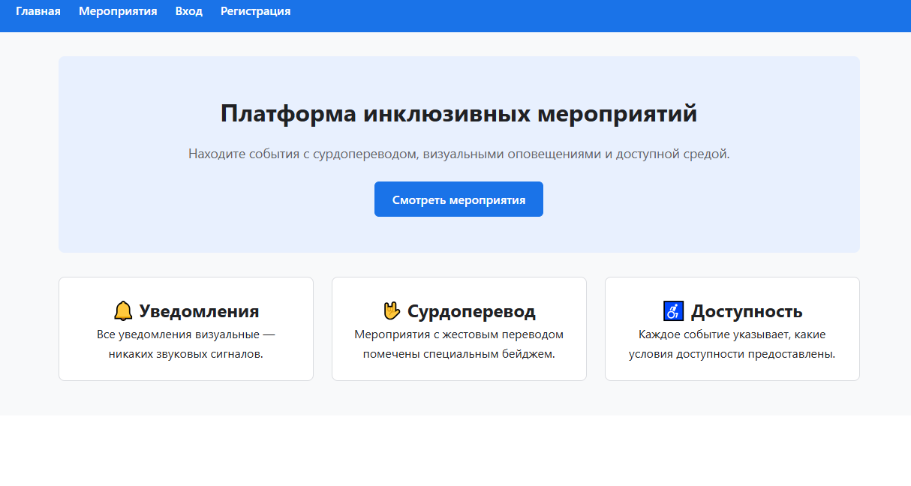
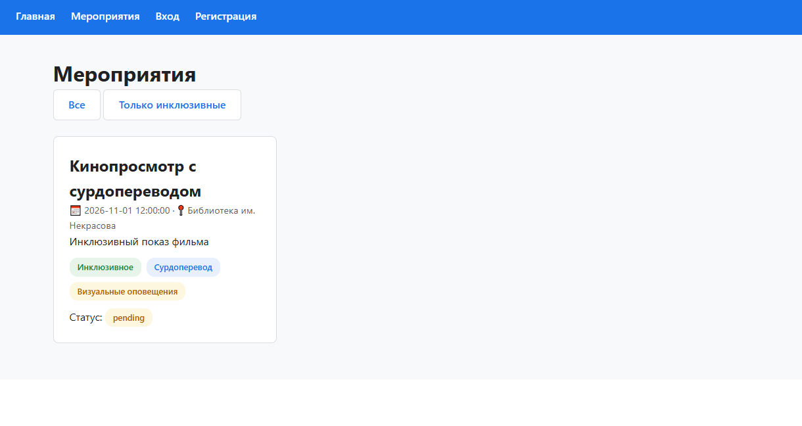
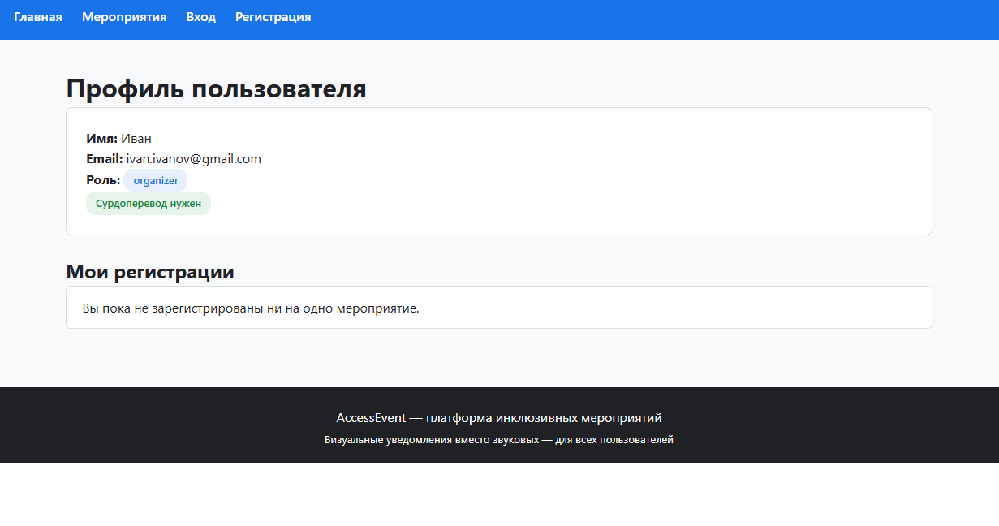

# AccessEvent — инклюзивная платформа мероприятий

Веб-платформа для организации мероприятий, доступная людям с нарушениями слуха: визуальные уведомления вместо звуковых, текстовый чат, цветовая индикация статусов.

## Стек технологий

| Слой | Технология |
|---|---|
| Backend | Python 3.11, Flask |
| База данных | PostgreSQL 16 |
| Frontend | HTML5, CSS3, JavaScript, Jinja2 |
| Тестирование | pytest |
| CI/CD | GitHub Actions |
| Контейнеризация | Docker, docker compose, GHCR |

## Как запустить
### Вариант 1. Docker (рекомендуется)
```bash
docker compose up
```
Открыть: http://127.0.0.1:5000

### Вариант 2. Локально
1. Установить зависимости: `pip install -r requirements.txt`
2. Запустить: `python app.py`

## Тесты
```bash
python -m pytest -v
```

## Скриншоты




## Ссылки на документацию
- [Тест-кейсы](docs/test_cases.md)
- [Баг-репорты](docs/bug_reports.md)
- [Руководство пользователя](docs/user_manual.md)
- [Руководство администратора](docs/admin_manual.md)
- [Описание API](docs/api.md)
- [Оценка ИС](docs/assessment.md)

## Автор
Студент курса ИСИП, учебная практика ПМ.05.  